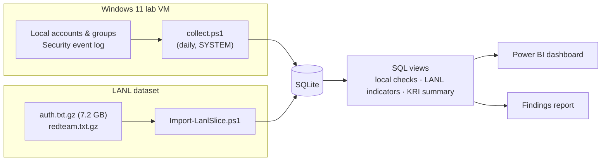
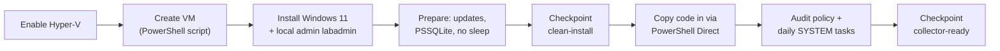

# Windows Identity Analytics Pipeline


[](#building-the-lab-vm)
[](https://github.com/joeywangtx/win_identity_analytics/actions/workflows/ci.yml)
[](LICENSE)

I built a small, realistic Windows environment and a tool that checks it every day for account security risks, the
kind that lead to break-ins: unused admin accounts, weak password settings, repeated failed sign-ins. The results feed
a Power BI dashboard with a red / amber / green status for each risk. I also tested how well simple warning signs spot
real attackers in 6.2 million sign-ins from a US national laboratory: the best one finds them about **135 times
better than chance**. On my own test machine, the tool found real problems, including an admin account that could
have had an empty password.

**Skills:** Identity & Access Management (IAM) · Windows security and audit logging · PowerShell automation · SQL and
data analysis · Power BI dashboards · Hyper-V virtualization · automated testing and CI (GitHub Actions)

<!-- DASHBOARD IMAGE: export the Overview page from Power BI and uncomment the line below.

-->

> **Docs:** this page covers what the project does and what it found. For installation, configuration, internals,
> testing and troubleshooting, see [ENGINEERING.md](ENGINEERING.md). The VM build is in [VM_SETUP.md](VM_SETUP.md),
> and the full evidence is in [report/findings.md](report/findings.md).

## Contents

1. [Key results](#key-results)
2. [Purpose](#purpose)
3. [How it works](#how-it-works)
4. [Building the lab VM](#building-the-lab-vm)
5. [Quick start](#quick-start)
6. [Methodology](#methodology)
7. [The data](#the-data)
8. [Results](#results)
9. [Problems I solved](#problems-i-solved)
10. [Recommendations](#recommendations)
11. [Limitations](#limitations)
12. [Repository layout](#repository-layout)
13. [References](#references)
14. [License](#license)

---

## Key results

| | Result |
|---|---|
| **It ran reliably** | The tool checked the test machine daily for 24 days with no failed check and no lost records. Twice the machine was off at check time, once for a security-update reboot, and the next check caught up. |
| **It found real problems** | I planted test accounts with known problems, and the tool caught every one that Windows let me set up. It also found three problems I hadn't planted: the machine's own admin account could have had an empty password, a disabled account kept being signed into, and an admin's rights were removed by an automated job, so no person is on record for the change. |
| **Best warning sign** | Users who suddenly sign in to many computers. In a review list of 50 people out of 16,000, it finds 19 of the 45 attackers, about 135 times better than picking at random. |
| **Most precise warning sign** | Combining "many computers" with "computers never used before": 12 of the top 20 people it flags are real attackers. |
| **What didn't work** | Failed passwords and older sign-in methods hardly separate attackers from normal users, and mixing them into a combined score made it worse. Many attackers sign in only once or twice a day, so no warning sign catches most of them in a short list. |
| **Built to be trusted** | 51 automated tests check every step against answers known in advance, and run on every change. |

The technical details behind each row are in [Results](#results).

## Purpose

Identity is where most intrusions start and spread: a stale admin account, a password that never expires, a burst of
failed logons, or one account suddenly touching dozens of machines. Identity and Access Management (IAM) and security
teams track these as KRIs: numbers with a threshold and a red / amber / green status that someone is accountable
for.

The project builds that pipeline end to end, from raw logs to a dashboard, to answer two questions:

1. **Can the hygiene KRIs be computed reliably from what Windows actually logs?** This covers dormant privileged
   accounts, password policy, lockouts and admin-group changes. Reliability means the logging is verified, nothing is
   counted twice or silently dropped, and every number traces back to an event.
2. **Do simple behavioural indicators find real attackers in enterprise data, and at what cost in false alarms?**
   Instead of claiming an indicator "detects lateral movement", each one is scored against labelled red-team activity.

## How it works



| Layer | Technology | Key files |
|---|---|---|
| Collection | PowerShell (`Get-LocalUser`, `Get-WinEvent`, Task Scheduler) | [collector/](collector/) |
| Enterprise import | PowerShell streaming gzip, `sqlite3 .import` | [lanl/Import-LanlSlice.ps1](lanl/Import-LanlSlice.ps1) |
| Storage and analytics | SQLite, SQL views | [sql/](sql/) |
| Reporting | Power BI (ODBC) | [powerbi/](powerbi/), [report/findings.md](report/findings.md) |
| Testing | Pester 5, GitHub Actions | [tests/](tests/), [.github/workflows/](.github/workflows/) |

How the collector avoids double counting, survives log clears and stays locale-independent is covered in
[ENGINEERING.md → Design notes](ENGINEERING.md#design-notes).

## Building the lab VM

Part 1 runs inside a Windows 11 virtual machine, `IDLAB-VM`. I built it from scratch on Hyper-V with PowerShell, and
it collected daily from 24 October to 17 November 2026. The full step-by-step guide, including the script that creates
the VM, is in [VM_SETUP.md](VM_SETUP.md).

### Why a VM

The collector needs a Windows machine where it is safe, and meaningful, to do things you would never do on a real
workstation:

- **It changes security settings and breaks accounts.** Setup rewrites the audit policy and sets an account lockout
  policy. The scenario adds a user to Administrators, triggers lockouts, and disables and deletes accounts.
- **It needs a known starting point.** A fresh VM has a short account list and an empty Security log, so nearly every
  event is either staged (and logged) or attributable to Windows. That makes the local checks testable against
  ground truth.
- **It must run for weeks.** Dormancy and "remove the temporary admin a week later" only appear over time.
- **It can be rolled back.** Checkpoints make any mistake a one-command undo.

### VM specification

| Setting | Value | Why |
|---|---|---|
| Hypervisor | Hyper-V (built into Windows 11 Pro) | No extra software; fully scriptable from PowerShell |
| OS | Windows 11 Enterprise evaluation | Free for 90 days, no product key needed |
| Generation | 2 | Required for Secure Boot and TPM |
| CPU / memory | 2 vCPUs, 4 GB fixed | Windows 11 minimums. Leaves the 16 GB host about 12 GB |
| Disk | 64 GB dynamic VHDX | Starts at about 25 GB and grows as needed |
| Network | Default Switch (NAT) | Internet access with no network setup |
| Security | Secure Boot (Windows template) + virtual TPM | Windows 11 setup refuses to install without them |

### How it was built



Code goes in, and the database comes out, through **PowerShell Direct** (`New-PSSession -VMName`), which talks to the
VM over the Hyper-V bus without any network shares.

### What I learned building it

- **Windows 11 has hard hardware requirements, even in a VM.** Without a Generation 2 VM, Secure Boot with the
  Microsoft template, a virtual TPM and fixed memory, setup refuses to install.
- **Scheduled tasks running as SYSTEM don't see your user profile.** Modules installed for the current user are
  invisible to SYSTEM, and so are passwords encrypted for your user. Both have to be stored machine-wide.
- **A VM only collects while it's running.** A paused or stopped VM logs nothing, and after a host reboot it stays off
  unless set to start automatically. The run history makes every gap visible instead of silent.
- **Take checkpoints at known-good points**, and copy the database out first: restoring one discards collected data.
- **Do Windows Update before collecting.** Updates add a lot of noise to the Security log.

A standalone VM has no Active Directory and therefore no domain-wide Kerberos events. Part 2 uses LANL for enterprise
scale.

## Quick start

The published synthetic database runs on any Windows machine. You only need the
[sqlite3 command-line tool](https://sqlite.org/download.html):

```powershell
git clone https://github.com/joeywangtx/win_identity_analytics
cd win_identity_analytics

# KRI summary (the dashboard's first page)
sqlite3 -header -column sample\sample.db "SELECT indicator, value, threshold, status FROM v_kri_summary;"

# Who has admin rights, with dormant and orphaned members flagged
sqlite3 -header -column sample\sample.db "SELECT * FROM v_privileged_accounts;"

# Detection indicators ranked by F1
sqlite3 -header -column sample\sample.db "SELECT indicator, top_n, precision, recall, f1 FROM lanl_detection_eval ORDER BY f1 DESC LIMIT 10;"
```

Run the tests (requires [Pester](https://pester.dev) 5.5+ and PSSQLite) with `Invoke-Pester .\tests`. For the lab VM
collector, the LANL import or the Power BI dashboard, see [ENGINEERING.md → Running](ENGINEERING.md#running).

## Methodology

| Part | Question | Data | Method | Output |
|---|---|---|---|---|
| **1. Collector** | What is the identity posture of this machine, day by day? | Lab VM: local accounts, groups, Security log | A daily snapshot plus the day's new security events, with staged test activity | A database of daily snapshots and events, and the local checks |
| **2. Enterprise analysis** | Do behavioural indicators rank attackers above normal users? | LANL authentication log: one baseline day, one detection day | Compute per-user indicators, compare the top N against red-team labels | Indicator scores and a precision/recall table |
| **3. Reporting** | What should the IAM team act on? | Results from parts 1–2 | KRI thresholds, a 5-page dashboard, a findings report | Power BI dashboard, [report/findings.md](report/findings.md) |

Steps:

1. **Verify logging before trusting it.** Enable the required Windows audit subcategories and save proof of the
   configuration. Missing events are a configuration problem, not a finding.
2. **Collect daily, without gaps or duplicates.** Each run records every account and group membership, then loads
   only the security events logged since the previous run. Gaps, such as log rollover, are detected and flagged.
3. **Stage known activity.** About 10 test accounts play out a scripted scenario: regular logons, dormant accounts, a
   temporary admin, lockouts, a disabled account, and the deletion of an account in a privileged group. Every staged
   action is logged as ground truth.
4. **Slice the enterprise data.** Choose a quiet baseline day and a busy red-team day from LANL, keep only user logon
   events, and record how many rows each filter removed.
5. **Learn "normal" from the baseline, then score the detection day.** Indicators such as *new user→computer pairs*
   are measured against each user's baseline history.
6. **Measure detection.** For each indicator, rank every user on the detection day, flag the top N
   (N = 5, 10, 20, 50, 100, 250), and compare the flagged users with the red-team labels.
7. **Summarise as KRIs.** Reduce each check to one row with a value, a threshold and a status
   ([thresholds](ENGINEERING.md#kri-thresholds)). The dashboard and the findings report are built on those rows.
8. **Test every step.** 51 Pester tests check each step against inputs whose correct answer is already known.

### Local checks

| Check | What it finds | Why it matters |
|---|---|---|
| Dormant accounts | Enabled accounts with no logon in more than 30 days, or never | Unused accounts are unmonitored credentials |
| Privileged accounts | Members of admin-level groups, with dormant and orphaned members flagged | Admin rights should be few and in active use |
| Password hygiene | Never-expires, not-required, and password age | Old or optional passwords are easy targets |
| Auth failures and lockouts | Failed logons by reason, and how fast each lockout came | Separates typos, spraying and brute force |
| Privileged group changes | Additions to and removals from admin groups, with who made them | Every change should match a ticket |
| Account lifecycle | Created / enabled / disabled / deleted / locked | Joiner-mover-leaver audit trail |
| Data quality and collector health | Orphaned SIDs, deleted accounts, missing descriptions, failed runs | A KRI is only as good as the data behind it |

### LANL indicators

Each indicator is computed per user over the detection day.

| Indicator | Score | Attack it targets |
|---|---|---|
| `failures` | Failed logons | Password guessing |
| `failure_burst` | Most failures in any one hour | Brute force (bursty, unlike typos) |
| `fan_out` | Distinct computers logged into | Lateral movement, scanning |
| `new_pairs` | User→computer pairs not seen in the baseline | Lateral movement to unfamiliar machines |
| `ntlm_logons` | Logons using NTLM instead of Kerberos | Pass-the-hash, legacy-protocol abuse |
| `rare_logon_types` | Remote desktop or cleartext-password logons | Interactive access, exposed credentials |
| `service_interactive` | Interactive logons by accounts that behave like services | A service credential used by a person |
| `combined_risk` | Average rank across failures, fan-out, new pairs, NTLM and rare types | Is a blended score better than any single signal? |
| `combined_lateral` | Average rank across fan-out and new pairs | The two lateral-movement signals together |

**Scoring.** For each indicator and each N, flag the N highest-scoring users, then compute:

- **Precision** = flagged red-team users ÷ flagged users. Of the alerts, how many were real?
- **Recall** = flagged red-team users ÷ all red-team users. Of the attackers, how many were caught?
- **F1** = the harmonic mean of precision and recall, used to select each indicator's best N.

A small N gives a short, high-precision alert queue. A large N catches more attackers but adds more false alarms.

## The data

| Data set | Contents | Published | Used for |
|---|---|---|---|
| **Sample** (`sample/sample.db`) | Synthetic local data plus a synthetic LANL-format slice | Yes | Trying everything without a lab or the LANL download, and the tests |
| **Lab VM** | Real collector output from the Windows 11 VM, 24 Oct – 17 Nov 2026 | No | Part 1 findings |
| **LANL slice** | Real enterprise authentication events, days 7–8 | No: download it from LANL ([1](#references)) | Part 2 detection results |

**Sample database.** Fully synthetic and deterministic: 21 daily runs for 14 accounts, each with one planted issue,
plus 300 LANL-format users with a 6-user red team and decoys built to fool each indicator. Its LANL half goes through
the real importer, so the sample exercises the production code path. The account-by-account scenario is in
[ENGINEERING.md → Sample database contents](ENGINEERING.md#sample-database-contents).

**Lab VM.** 24 collector runs: 10,548 authentication events and 134 account and group changes. The data mixes staged
activity (every action logged to `staged_activity.csv`) with organic activity from Windows and my own use, and the
findings report separates the two. The staged scenario ran from 6 to 15 November; the day-by-day run log, including
what went wrong, is in [ENGINEERING.md → Lab VM run log](ENGINEERING.md#lab-vm-run-log).

**LANL.** The **Comprehensive, Multi-Source Cyber-Security Events** dataset ([1](#references)) covers 58 days of
LANL's corporate network, with names anonymised and released under CC0. In plain terms, `auth.txt.gz` (7.2 GB) is a
record of every logon on a network of about 16,000 daily users: who logged on, from which computer, to which
computer, how, and whether it worked. `redteam.txt.gz` lists the logons made by LANL's own security team while it
played the attacker, which gives an answer key to grade the indicators against.

**Why days 7 and 8?**

- **Day 8 is the detection day** because it has the most red-team activity in the whole dataset: 45 attacker
  accounts. Day 12 comes next with 39, and most days with any red-team activity have only 1 to 4. More attackers to
  find makes precision and recall meaningful instead of hinging on a handful of users.
- **Day 7 is the baseline** because it's the day right before and almost free of attackers (a single red-team
  event). Indicators like *new user→computer pairs* learn "normal" from the baseline, so it needs to be clean, and
  close enough in time that normal behaviour hasn't changed.
- **They're early in the file.** The log is sorted by time, so the importer can stop after day 8, reading about
  150 million lines instead of more than a billion.

After keeping only user logons, **6.2 million events** remain (3.1M per day). About 16,000 users are active per day,
of whom 45 are labelled red team: a base rate of **0.28%**. The row counts per filter are in
[ENGINEERING.md → LANL slice](ENGINEERING.md#lanl-slice), and the download and slice choice in
[lanl/README.md](lanl/README.md).

## Results

### Lab VM

KRIs as of the last run (17 November 2026). Full evidence for each row is in
[report/findings.md](report/findings.md).

| KRI | Value | Status | Cause |
|---|---|---|---|
| Dormant privileged accounts | 1 | 🔴 red | `dormant_alice` in Administrators, never signed in (staged) |
| Password not required | 2 | 🔴 red | `temp_contractor` (staged) and **`labadmin`**, the lab's own admin account (organic) |
| Password never expires | 3 | 🟠 amber | `svc_backup` (staged); `labadmin` and the owner's Microsoft account (organic) |
| Privileged group changes (7 days) | 2 | 🟠 amber | `dormant_bob` removed from Backup Operators when deleted; `helpdesk_tom` removed from Administrators |
| Lockouts in last 7 days | 1 | 🟢 green | `temp_contractor` on 15 Nov. The 8 Nov lockout is outside the window |
| Passwords older than 365 days | 0 | 🟢 green | Can't be staged: Windows doesn't allow a backdated password |
| Orphaned SIDs in groups | 0 | 🟢 green | Deleting a local account removes it from its groups |
| Security log cleared (30 days) | 0 | 🟢 green | None |
| Failed collector runs (14 days) | 0 | 🟢 green | 24 of 24 runs succeeded |
| Failed logons in last 7 days | 22 | info | Typos, lockout attempts and the disabled account; 33 of 36 all-time failures are staged |

<!-- DASHBOARD IMAGE: export the "Privileged access & hygiene" page and uncomment the line below.

-->

What the VM showed that the sample couldn't:

- **The scenario found real problems.** `labadmin` was created with `New-LocalUser`, which silently sets "password not
  required". It now sits in Administrators with a password that may be blank.
- **A disabled account kept being tried.** `mjones` got 8 failed sign-ins with reason "account disabled" after it
  was disabled. On a real network, that means something still holds a leaver's password.
- **The temporary admin was removed by the machine.** The removal is attributed to `IDLAB-VM$` (a scheduled task
  running as SYSTEM), not a person. `helpdesk_tom`'s sign-ins confirm both changes independently: Windows gives an
  admin two sessions per sign-in, and the count doubles on 8 Nov and halves again on 15 Nov.
- **No orphaned SID on a standalone machine.** Deleting `dormant_bob` removed it from its groups in the same second.
  Orphans need a domain or cloud account deleted elsewhere, so only the sample database shows that KRI.
- **7-day KRIs show part of a longer story.** The scenario took 8 days. On 17 November the KRIs show the admin
  removal but not the grant, and one of the two lockouts. The event views hold the full history.
- **Staged activity is a sliver of the log.** 97% of successful sign-ins are Windows service sign-ins, and only 1.4%
  are staged.

<!-- DASHBOARD IMAGE: export the "Authentication" page and uncomment the line below.

-->

### LANL enterprise data

Baseline day 7, detection day 8, 45 red-team users among ~16,000 active users. **N** is the number of top-scoring
users flagged per indicator, which works like an analyst's daily review budget; **best N** is the N with the highest
F1 for that indicator:

| Indicator | Best N | Red team caught | Precision | Recall | F1 |
|---|---|---|---|---|---|
| `fan_out` | 50 | 19 | 0.38 | 0.42 | **0.40** |
| `combined_lateral` | 20 | 12 | 0.60 | 0.27 | 0.37 |
| `new_pairs` | 20 | 10 | 0.50 | 0.22 | 0.31 |
| `combined_risk` | 20 | 8 | 0.40 | 0.18 | 0.25 |
| `service_interactive` | 50 | 5 | 0.10 | 0.11 | 0.11 |
| `failure_burst` | 100 | 7 | 0.07 | 0.16 | 0.10 |
| `failures` | 250 | 13 | 0.05 | 0.29 | 0.09 |
| `rare_logon_types` | 250 | 9 | 0.04 | 0.20 | 0.06 |
| `ntlm_logons` | 10 | 1 | 0.10 | 0.02 | 0.04 |

<!-- DASHBOARD IMAGE: export the "Detection results" page and uncomment the line below.

-->

Interpretation:

- **Lateral-movement indicators perform far better than chance.** At a 0.28% base rate, 50 random users would include
  about 0.14 red-team users. `fan_out` catches 19.
- **Recall is limited.** Even at N = 250, `combined_risk` reaches only 58% recall. Many red-team users have only one
  or two normal-looking logons on day 8.
- **A focused score beats a blended one.** `combined_risk` weights failures, NTLM and rare logon types equally with
  the lateral signals, which dilutes them. `combined_lateral` holds up better. This reverses the sample result, which
  is why testing on real data matters.
- **Failure- and NTLM-based indicators are close to noise** for this red team. NTLM accounts for 22% of
  detection-day logons, so it describes the network more than the attackers.
- **Precision is a lower bound.** The labels are incomplete, so some "false positives" may be real, unlabelled
  anomalies.

Resulting KRIs: 632 users with 5+ new computer pairs (amber), NTLM share 22.36% (amber), best F1 0.40.

### Sample database

Every red and amber KRI on the sample traces back to exactly one planted account, and the automated tests check
this. Its synthetic red team is built to be findable (precision 1.0 at N = 5), so it validates the pipeline, not
the indicators. The full table is in [ENGINEERING.md → Sample database contents](ENGINEERING.md#sample-database-contents).

## Problems I solved

Each of these broke something real, and each fix is covered by a test or documented in
[ENGINEERING.md](ENGINEERING.md):

- **A cleared Security log made the collector go blind.** Event record IDs restart after a log clear, so new events
  looked like duplicates and were skipped. The collector now detects the reset and starts a new "log epoch".
  ([Design notes](ENGINEERING.md#design-notes))
- **A scheduled task that failed silently for two days.** The script worked by hand but exited with code 1 as a
  task, because Windows PowerShell leaves `$PSScriptRoot` empty in parameter defaults under `-File`. I reproduced it,
  fixed four scripts, and made both tasks log their output so the next failure is visible.
  ([Troubleshooting](ENGINEERING.md#is-the-staged-activity-running))
- **Passwords that only one user could read.** Test-account passwords were encrypted for my user, so the SYSTEM task
  couldn't decrypt them. They are now encrypted for the machine and locked down with a file ACL.
- **An old SQLite inside the PowerShell module.** PSSQLite bundles SQLite 3.8.8 from 2015, and one modern view would
  break the collector. Persistent views use 3.8.8 SQL; the LANL analysis runs in the modern CLI.
  ([Design notes](ENGINEERING.md#design-notes))
- **A scenario step that can't work.** I expected deleting `dormant_bob` to leave an orphaned SID. The data showed
  Windows cleans up local group memberships, so I documented the limitation instead of faking the result.

## Recommendations

These follow from the results above: the local items from the sample and the lab VM, the analytics items from LANL.

### Security

- **Remove dormant privileged access.** Disable dormant admin accounts or remove them from privileged groups, and
  review admin-group membership regularly.
- **Check new accounts for silent defaults.** `New-LocalUser` sets "password not required" on every account it
  creates, and the lab's own admin account had it. Run a flag check as the last step of every provisioning script.
- **Hunt down stale credentials for disabled accounts.** A sign-in failing with "account disabled" means a
  leaver's password is still stored somewhere. Find the source and remove it before the account is ever re-enabled.
- **Clean group memberships before deleting domain accounts.** Windows cleans up local accounts (the lab VM confirmed
  it), but not domain or cloud accounts in local groups. Make "remove from all groups" a required offboarding step.
- **Fix password exceptions.** Clear the password-not-required flag, rotate passwords older than 365 days, and move
  service accounts with never-expiring passwords to managed service accounts with automatic rotation.
- **Make admin rights temporary by default.** Grant temporary admin rights through just-in-time access with an
  expiry and a ticket, instead of relying on someone remembering to remove them.
- **Reduce NTLM.** At 22% of logons, NTLM is too common to be a useful attack signal, but it remains a pass-the-hash
  risk. Audit which hosts and applications still depend on it, and phase it out.

### Analytics

- **Rank by lateral movement first.** Use `combined_lateral` for a short, high-precision queue (0.60 at N = 20) and
  `fan_out` for broader coverage (19 of 45 at N = 50). Set N to match how many users analysts can review.
- **Reweight `combined_risk`.** Weight each signal by its measured F1, or keep weak signals for context only.
- **Use a longer baseline.** A one-day baseline makes many ordinary users look like they're touching new computers
  (632 users with 5+ new pairs). A rolling multi-day baseline, plus peer-group baselines for admins, should reduce
  false positives.
- **Scale thresholds to the population.** A fixed "more than 10 users" threshold fits 300 users but will always fire
  at 16,000. Use a rate or a percentile instead.
- **Broaden the evaluation.** Test across all red-team days, and add LANL process, flow and DNS data to catch
  low-activity attackers.

### Monitoring

- **Alert on each privileged group change.** A 7-day count missed both of `helpdesk_tom`'s changes in the sample,
  and on the VM it showed the removal without the grant. Match each change to a ticket when it happens, and run
  automated changes under a named identity, not SYSTEM, so the log shows who is accountable.
- **Alert on sign-ins to disabled accounts.** Sub-status `0xC0000072` is rare and specific, unlike raw failure
  counts, which hid it on the VM.
- **Alert on collector failures the same day.** A missed run should notify someone immediately, not just turn a KRI
  amber.
- **Size the Security log for the collection interval**, and alert in real time on overwrite gaps and log clears.
- **Separate lockout causes.** Use failure speed and source to tell spraying or brute force (many accounts, one
  source, fast) apart from stale saved passwords (one account, steady).
- **Track detection quality over time.** Re-run the precision/recall evaluation whenever indicators or thresholds
  change.

## Limitations

- The local half runs on a single standalone VM with mostly staged activity. There is no Active Directory, so there
  are no domain events.
- The lab VM scenario ran over 8 days, with two steps late and two days without staged activity. A new VM can't
  produce an old password or a local orphaned SID, so those KRIs are only exercised by the sample.
- The LANL evaluation covers one baseline day and one detection day. Results may differ on other days.
- LANL red-team labels are incomplete, so precision is a lower bound.
- The sample database is synthetic and built to be detectable. It validates the code, not the detection performance.

## Repository layout

```
collector/   PowerShell collector module, entry point, audit setup, staged activity, task registration
lanl/        LANL streaming importer and dataset notes
sql/         Schema, local views, LANL indicator views, KRI summary
tests/       Pester tests and fixtures
sample/      Synthetic database and the script that builds it
powerbi/     Dashboard notes and screenshots
report/      Findings report
data/        Git-ignored: VM database, LANL slice, staged-activity log, audit evidence
```

Real data is never committed. This includes the VM database, `.evtx` exports and LANL records. Only aggregate results,
such as the tables above, are published.

| Document | Covers |
|---|---|
| [ENGINEERING.md](ENGINEERING.md) | Architecture, installation, configuration, schema, data details, testing, troubleshooting |
| [VM_SETUP.md](VM_SETUP.md) | Building the Hyper-V lab VM and running the staged scenario |
| [lanl/README.md](lanl/README.md) | LANL download, terms, slice selection, filtering |
| [powerbi/README.md](powerbi/README.md) | ODBC connection, imported tables, dashboard pages |
| [report/findings.md](report/findings.md) | Findings, evidence and recommendations |

## References

1. A. D. Kent, "Comprehensive, Multi-Source Cybersecurity Events," Los Alamos National Laboratory, 2015.
   <http://dx.doi.org/10.17021/1179829>. Dataset page: <https://csr.lanl.gov/data/cyber1/>. Released under CC0.

## License

MIT — see [LICENSE](LICENSE). The LANL dataset used for the enterprise analysis is public domain (CC0) and is not
redistributed here; only aggregate results derived from it are published.
