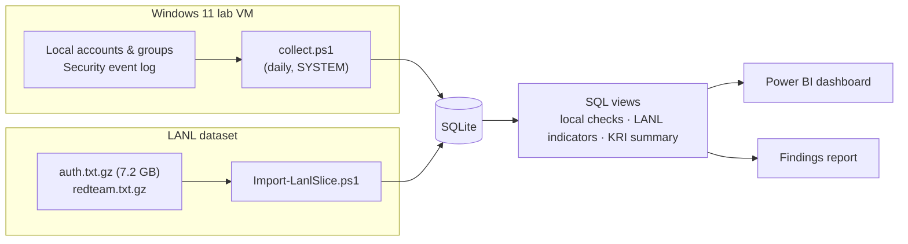

# Windows Identity Analytics Pipeline


An end-to-end identity risk analytics pipeline. It collects account, group and authentication data from Windows,
computes identity **key risk indicators (KRIs)** in SQL, and reports them in Power BI. It then applies behavioural
indicators to real enterprise authentication logs from Los Alamos National Laboratory ([LANL](#references)) and
measures how well they detect a labelled red team, using precision, recall and F1.

> **Docs:** this page covers purpose, method and results. For installation, configuration, testing and
> troubleshooting, see [ENGINEERING.md](ENGINEERING.md).

## Contents

1. [Key results](#key-results)
2. [Purpose](#purpose)
3. [Architecture](#architecture)
4. [Quick start](#quick-start)
5. [Methodology](#methodology)
6. [The data](#the-data)
7. [Analytics](#analytics)
8. [Why a VM](#why-a-vm)
9. [Results](#results)
10. [Recommendations](#recommendations)
11. [Limitations](#limitations)
12. [Repository layout](#repository-layout)
13. [References](#references)

---

## Key results

| | Result |
|---|---|
| **Pipeline** | Collector → SQLite → SQL KRIs → Power BI, working end to end. On the synthetic sample, every red/amber KRI traces back to exactly one staged account, and 48 Pester tests check this. |
| **Hygiene KRIs** | Can be computed reliably from Windows logs, as long as audit logging is verified first and collector gaps are tracked as a KRI. |
| **Best detector (LANL)** | `fan_out` catches **19 of 45** red-team users in a list of 50, about **135× better than chance** (F1 0.40). |
| **Highest precision (LANL)** | `combined_lateral`: 0.60 precision in a 20-user list. `combined_risk` is 5 for 5 at N = 5. |
| **Weak signals** | Failure-, NTLM- and logon-type indicators are close to noise. Blending them in makes the combined score worse. |
| **Main gap** | No indicator catches most attackers in a short list. Many red-team users log on only once or twice on the detection day. |
| **Lab VM** | Collection in progress, ending around 7 November 2026. Results will be added afterwards. |

**N** is the number of top-scoring users flagged per indicator, which works like an analyst's daily review budget.
**Best N** is the N with the highest F1 for that indicator.

## Purpose

Identity is where most intrusions start and spread: a stale admin account, a password that never expires, a burst of
failed logons, or one account suddenly touching dozens of machines. Identity and Access Management (IAM) and security
teams track these as KRIs: numbers with a threshold and a red / amber / green status that someone is accountable
for.

The project builds that pipeline end to end, from raw logs to a dashboard, to answer two questions:

1. **Can the hygiene KRIs be computed reliably from what Windows actually logs?** This covers dormant privileged
   accounts, password policy, lockouts and admin-group changes. Reliability means the logging is verified, nothing is
   counted twice or silently dropped, and every number traces back to an event.
2. **Do simple behavioural indicators find real attackers in enterprise data, and at what cost in false alarms?**
   Instead of claiming an indicator "detects lateral movement", each one is scored against labelled red-team activity.

## Architecture



| Layer | Technology | Key files |
|---|---|---|
| Collection | PowerShell (`Get-LocalUser`, `Get-WinEvent`, Task Scheduler) | [collector/](collector/) |
| Enterprise import | PowerShell streaming gzip, `sqlite3 .import` | [lanl/Import-LanlSlice.ps1](lanl/Import-LanlSlice.ps1) |
| Storage and analytics | SQLite, SQL views | [sql/](sql/) |
| Reporting | Power BI (ODBC) | [powerbi/](powerbi/), [report/findings.md](report/findings.md) |
| Testing | Pester 5 | [tests/](tests/) |

Design highlights: incremental, idempotent loading keyed on `EventRecordID`; detection of gaps from log rollover and
log clearing; orphaned-SID handling; locale-safe matching by SID and GUID; and reproducible time references. See
[ENGINEERING.md → Design notes](ENGINEERING.md#design-notes).

## Quick start

The published synthetic database runs on any Windows machine. You only need the
[sqlite3 command-line tool](https://sqlite.org/download.html):

```powershell
git clone https://github.com/joeywangtx/win_identity_analytics
cd win_identity_analytics

# KRI summary (the dashboard's first page)
sqlite3 -header -column sample\sample.db "SELECT indicator, value, threshold, status FROM v_kri_summary;"

# Who has admin rights, with dormant and orphaned members flagged
sqlite3 -header -column sample\sample.db "SELECT * FROM v_privileged_accounts;"

# Detection indicators ranked by F1
sqlite3 -header -column sample\sample.db "SELECT indicator, top_n, precision, recall, f1 FROM lanl_detection_eval ORDER BY f1 DESC LIMIT 10;"
```

Run the tests (requires [Pester](https://pester.dev) 5.5+ and PSSQLite):

```powershell
Invoke-Pester .\tests
```

For the lab VM collector, the LANL import or the Power BI dashboard, see
[ENGINEERING.md → Running](ENGINEERING.md#running).

## Methodology

The work has three parts. Each part produces something the next one uses.

| Part | Question | Data | Method | Output |
|---|---|---|---|---|
| **1. Collector** | What is the identity posture of this machine, day by day? | Lab VM: local accounts, groups, Security log | A daily snapshot plus the day's new security events, with staged test activity | A database of daily snapshots and events, and the local checks |
| **2. Enterprise analysis** | Do behavioural indicators rank attackers above normal users? | LANL authentication log: one baseline day, one detection day | Compute per-user indicators, compare the top N against red-team labels | Indicator scores and a precision/recall table |
| **3. Reporting** | What should the IAM team act on? | Results from parts 1–2 | KRI thresholds, a 5-page dashboard, a findings report | Power BI dashboard, [report/findings.md](report/findings.md) |

Steps:

1. **Verify logging before trusting it.** Enable the required Windows audit subcategories and save proof of the
   configuration. Missing events are a configuration problem, not a finding.
2. **Collect daily, without gaps or duplicates.** Each run records every account and group membership, then loads
   only the security events logged since the previous run. Gaps, such as log rollover, are detected and flagged.
3. **Stage known activity.** About 10 test accounts play out a scripted scenario: regular logons, dormant accounts, a
   temporary admin, lockouts, and a deleted account left behind in a group. Every staged action is logged as
   ground truth.
4. **Slice the enterprise data.** Choose a quiet baseline day and a busy red-team day from LANL, keep only user logon
   events, and record how many rows each filter removed.
5. **Learn "normal" from the baseline, then score the detection day.** Indicators such as *new user→computer pairs*
   are measured against each user's baseline history.
6. **Measure detection.** For each indicator, rank every user on the detection day, flag the top N
   (N = 5, 10, 20, 50, 100, 250), and compare the flagged users with the red-team labels.
7. **Summarise as KRIs.** Reduce each check to one row with a value, a threshold and a status. The dashboard and the
   findings report are built on those rows.
8. **Test every step.** 48 Pester tests check each step against inputs whose correct answer is already known.

## The data

| Data set | Contents | Published | Used for |
|---|---|---|---|
| **Sample** (`sample/sample.db`) | Synthetic local data plus a synthetic LANL-format slice | Yes | Trying everything without a lab or the LANL download |
| **Lab VM** | Real collector output from a Windows 11 virtual machine | No | Part 1 findings |
| **LANL slice** | Real enterprise authentication events, days 7–8 | No: download it from LANL ([1](#references)) | Part 2 detection results |

### Sample database

Fully synthetic and deterministic. The LANL half is written in the real LANL file format and loaded through the real
importer, so the sample exercises the production code path.

**Local half:** 21 daily runs (2–22 October 2026) for host `IDLAB-VM`, with 14 accounts, 515 authentication events
and 9 account changes:

| Account | Scenario | Expected finding |
|---|---|---|
| `labadmin` | Lab owner, daily admin logons | None (the normal case) |
| `jsmith`, `mjones`, `akim` | Regular users, weekday logons, occasional typos | Background failed-logon noise. `mjones` is disabled on day 13 |
| `helpdesk_tom` | Added to Administrators on day 4, removed on day 11 | Two privileged group changes by `labadmin` |
| `svc_backup` | Service logons around the clock, password never expires, password set 2025-11 | Password never expires |
| `svc_report` | Service account with no description | Data-quality issue |
| `temp_contractor` | Password not required; locked out twice (days 6 and 17) | Password not required (red), 2 lockouts |
| `old_pwd_carl` | Password last set 2025-03 | Password older than 365 days |
| `dormant_alice` | In Administrators, never logs on | **Dormant privileged account** (red) |
| `dormant_bob` | Never logs on; deleted on day 14 while still in Backup Operators | Orphaned SID in a privileged group |
| *(nonexistent `admin`)* | Password-spray noise from 192.168.56.50 every third day | Failures for an unknown user |

Run 9 is recorded as **failed** (the VM was suspended), so the collector-health KRI has a real case to catch.

**LANL half:** 300 users across two days, 33,665 lines read and 18,349 kept. A red team of **6 users** moves laterally
to 8–20 never-seen computers each. Decoy groups make detection non-trivial:

| Decoy group | Behaviour | Indicator it fools |
|---|---|---|
| 8 admins | High fan-out every day, including the baseline | `fan_out` (not `new_pairs`, because the pairs aren't new) |
| 12 "movers" | Start using a few new servers on the detection day | `new_pairs` at larger N |
| 7 stale-password users | Bursts of failed NTLM logons | `failures`, `failure_burst` |
| 5 service accounts | Active all day; one logs on interactively | `service_interactive` |
| ~10% of users | Still on NTLM | `ntlm_logons` |

### Lab VM data

A Windows 11 VM runs the collector daily as SYSTEM. Each run records account snapshots, group membership (including
unresolvable members), authentication events, account-lifecycle and group-change events, Security-log clears, and run
history. The data mixes staged activity (all listed in a log of staged actions) with organic Windows activity. The
findings report separates the two.

**Status:** collecting since 24 October 2026, with one successful run per day and about 630 events per day.

### LANL enterprise authentication data

The **Comprehensive, Multi-Source Cyber-Security Events** dataset ([1](#references)) covers 58 days of LANL's
corporate network, with user and computer names anonymised. It pairs real enterprise-scale identity logs with
ground-truth red-team labels, and it is released under CC0. This project uses `auth.txt.gz` (7.2 GB) and
`redteam.txt.gz` (4.8 KB). The process, flow and DNS files are not used.

**Slice:** baseline = **day 7** (1 red-team event, nearly clean), detection = **day 8** (the busiest red-team day,
273 events by 45 users).

| Step | Rows |
|---|---|
| Lines read (stopped at the end of day 8) | 152,468,275 |
| Before the window (days 0–6, skipped) | 113,699,303 |
| In the window (days 7–8) | 38,768,971 |
| Removed: not a logon (logoffs, Kerberos ticket requests) | 22,494,657 |
| Removed: computer accounts | 10,053,920 |
| **Kept for analysis** | **6,220,394** (3.12M baseline, 3.10M detection) |

About 16,000 users are active per day, of whom 45 are labelled red team: a base rate of **0.28%**. Download steps and
slice-selection details are in [lanl/README.md](lanl/README.md).

## Analytics

### Local checks

| Check | What it finds | Why it matters |
|---|---|---|
| Dormant accounts | Enabled accounts with no logon in more than 30 days, or never | Unused accounts are unmonitored credentials |
| Privileged accounts | Members of admin-level groups, with dormant and orphaned members flagged | Admin rights should be few and in active use |
| Password hygiene | Never-expires, not-required, and password age (0–90 / 90–365 / 365+ days) | Old or optional passwords are easy targets |
| Daily auth failures | Failed logons by day, account, logon type and reason | Separates typos, unknown-user spraying and locked accounts |
| Lockouts | Each lockout, with the failures before it and how fast they came | Brute force vs. a stale saved password |
| Privileged group changes | Additions to and removals from admin groups, with who made them | Every change should match a ticket |
| Account lifecycle | Created / enabled / disabled / deleted / changed / locked / unlocked | Joiner-mover-leaver audit trail |
| Data quality | Orphaned SIDs, accounts without descriptions, events for deleted accounts | Gaps in the data are findings too |
| Collector health | Each run's status and volume | A KRI is only as good as the run behind it |

### LANL indicators

Each indicator is computed per user over the detection day.

| Indicator | Score | Attack it targets |
|---|---|---|
| `failures` | Failed logons | Password guessing |
| `failure_burst` | Most failures in any one hour | Brute force (bursty, unlike typos) |
| `fan_out` | Distinct computers logged into | Lateral movement, scanning |
| `new_pairs` | User→computer pairs not seen in the baseline | Lateral movement to unfamiliar machines |
| `ntlm_logons` | Logons using NTLM instead of Kerberos | Pass-the-hash, legacy-protocol abuse |
| `rare_logon_types` | Remote desktop or cleartext-password logons | Interactive access, exposed credentials |
| `service_interactive` | Interactive logons by accounts that behave like services | A service credential used by a person |
| `combined_risk` | Average rank across failures, fan-out, new pairs, NTLM and rare types | Is a blended score better than any single signal? |
| `combined_lateral` | Average rank across fan-out and new pairs | The two lateral-movement signals together |

`ANONYMOUS LOGON` is a protocol artefact, not a person, so it is excluded from user scoring and reported per computer.

**Scoring.** For each indicator and each N, flag the N highest-scoring users, then compute:

- **Precision** = flagged red-team users ÷ flagged users. Of the alerts, how many were real?
- **Recall** = flagged red-team users ÷ all red-team users. Of the attackers, how many were caught?
- **F1** = the harmonic mean of precision and recall, used to select each indicator's best N.

A small N gives a short, high-precision alert queue. A large N catches more attackers but adds more false alarms.

### KRI thresholds

| KRI | Status rule |
|---|---|
| Dormant privileged accounts, password not required, Security log cleared (30 days) | > 0 → red |
| Password never expires, passwords older than 365 days, orphaned SIDs, failed collector runs (14 days), privileged group changes (7 days) | > 0 → amber |
| Lockouts in last 7 days | > 3 → amber |
| LANL users with 5+ new computer pairs | > 10 → amber |
| LANL NTLM share of logons | > 5% → amber |
| Failed logons (7 days), LANL best F1 | Context only (`info`) |

Thresholds are defined in [sql/kri_summary.sql](sql/kri_summary.sql).

## Why a VM

The local half needs a Windows machine where it is safe, and meaningful, to do things you would never do on a real
workstation:

- **It changes security settings.** Setup rewrites the audit policy, resizes the Security log and sets an account
  lockout policy.
- **It creates, breaks and deletes accounts.** The scenario adds a user to Administrators, triggers lockouts and
  deletes an account that is still in a group.
- **It needs a known starting point.** A fresh VM has a short account list and an empty Security log, so nearly every
  event is either staged (and logged) or attributable to Windows. That makes the local checks testable against
  ground truth.
- **It must run for weeks.** Dormancy, password age and "remove the temporary admin a week later" only appear over
  time.
- **It can be rolled back.** VM checkpoints make any mistake a one-command undo.

A standalone VM has no Active Directory and therefore no domain-wide Kerberos events. Part 2 uses LANL for enterprise
scale. VM build steps are in [VM_SETUP.md](VM_SETUP.md).

## Results

### Sample database

| KRI | Value | Status | Cause |
|---|---|---|---|
| Dormant privileged accounts | 1 | 🔴 red | `dormant_alice` in Administrators, never logged on |
| Password not required | 1 | 🔴 red | `temp_contractor` |
| Password never expires | 1 | 🟠 amber | `svc_backup` |
| Passwords older than 365 days | 1 | 🟠 amber | `old_pwd_carl` (set 2025-03) |
| Orphaned SIDs in groups | 1 | 🟠 amber | Deleted `dormant_bob` still in Backup Operators |
| Failed collector runs (14 days) | 1 | 🟠 amber | Run 9 (VM suspended) |
| Lockouts in last 7 days | 1 | 🟢 green | `temp_contractor` on 18 Oct (below the threshold of 3) |
| Privileged group changes (7 days) | 0 | 🟢 green | `helpdesk_tom`'s changes on days 4 and 11 fall outside the window |
| Security log cleared (30 days) | 0 | 🟢 green | None |
| Failed logons in last 7 days | 23 | info | Typos, spraying and the lockout |
| LANL users with 5+ new pairs | 12 | 🟠 amber | 6 red team + 6 movers |
| LANL NTLM share | 10.37% | 🟠 amber | ~10% of synthetic users on NTLM |
| LANL best indicator F1 | 0.909 | info | `new_pairs` / `combined_risk` at N = 5 |

Every red and amber row traces back to exactly one staged account, and the automated tests check this. On the
sample, `new_pairs` and `combined_risk` reach precision 1.0 and recall 0.83 at N = 5, and recall 1.0 at N = 10. This
is expected, because the synthetic red team is built to be findable. It validates the pipeline, not the indicators.

### LANL enterprise data

Baseline day 7, detection day 8, 45 red-team users among ~16,000 active users. Best N per indicator, by F1:

| Indicator | Best N | Red team caught | Precision | Recall | F1 |
|---|---|---|---|---|---|
| `fan_out` | 50 | 19 | 0.38 | 0.42 | **0.40** |
| `combined_lateral` | 20 | 12 | 0.60 | 0.27 | 0.37 |
| `new_pairs` | 20 | 10 | 0.50 | 0.22 | 0.31 |
| `combined_risk` | 20 | 8 | 0.40 | 0.18 | 0.25 |
| `service_interactive` | 50 | 5 | 0.10 | 0.11 | 0.11 |
| `failure_burst` | 100 | 7 | 0.07 | 0.16 | 0.10 |
| `failures` | 250 | 13 | 0.05 | 0.29 | 0.09 |
| `rare_logon_types` | 250 | 9 | 0.04 | 0.20 | 0.06 |
| `ntlm_logons` | 10 | 1 | 0.10 | 0.02 | 0.04 |

Interpretation:

- **Lateral-movement indicators perform far better than chance.** At a 0.28% base rate, 50 random users would include
  about 0.14 red-team users. `fan_out` catches 19.
- **Recall is limited.** Even at N = 250, `combined_risk` reaches only 58% recall. Many red-team users have only one
  or two normal-looking logons on day 8.
- **A focused score beats a blended one.** `combined_risk` weights failures, NTLM and rare logon types equally with
  the lateral signals, which dilutes them. `combined_lateral` holds up better. This reverses the sample result, which
  is why testing on real data matters.
- **Failure- and NTLM-based indicators are close to noise** for this red team. NTLM accounts for 22% of
  detection-day logons, so it describes the network more than the attackers.
- **Precision is a lower bound.** The labels are incomplete, so some "false positives" may be real, unlabelled
  anomalies.

Resulting KRIs: 632 users with 5+ new computer pairs (amber), NTLM share 22.36% (amber), best F1 0.40.

### Lab VM

Results will be published in this section and in [report/findings.md](report/findings.md) after collection ends.
If the staged scenario runs as planned, the VM's KRIs should follow the sample pattern, with organic Windows activity
(service logons, updates, unscripted failures) on top.

## Recommendations

These follow from the results above. Local-hygiene items are based on the sample scenario and will be validated
against the VM results.

### Security

- **Remove dormant privileged access.** Disable dormant admin accounts or remove them from privileged groups, and
  review admin-group membership regularly.
- **Clean group memberships before deleting accounts.** An orphaned SID in Backup Operators means deprovisioning
  deleted the account but left its privilege behind. Make "remove from all groups" a required offboarding step.
- **Fix password exceptions.** Clear the password-not-required flag, rotate passwords older than 365 days, and move
  service accounts with never-expiring passwords to managed service accounts with automatic rotation.
- **Make admin rights temporary by default.** Grant temporary admin rights through just-in-time access with an
  expiry and a ticket, instead of relying on someone remembering to remove them.
- **Reduce NTLM.** At 22% of logons, NTLM is too common to be a useful attack signal, but it remains a pass-the-hash
  risk. Audit which hosts and applications still depend on it, and phase it out.

### Analytics

- **Rank by lateral movement first.** Use `combined_lateral` for a short, high-precision queue (0.60 at N = 20) and
  `fan_out` for broader coverage (19 of 45 at N = 50). Set N to match how many users analysts can review.
- **Reweight `combined_risk`.** Weight each signal by its measured F1, or keep weak signals for context only.
- **Use a longer baseline.** A one-day baseline makes many ordinary users look like they're touching new computers
  (632 users with 5+ new pairs). A rolling multi-day baseline, plus peer-group baselines for admins, should reduce
  false positives.
- **Scale thresholds to the population.** A fixed "more than 10 users" threshold fits 300 users but will always fire
  at 16,000. Use a rate or a percentile instead.
- **Broaden the evaluation.** Test across all red-team days, and add LANL process, flow and DNS data to catch
  low-activity attackers.

### Monitoring

- **Alert on collector failures the same day.** A missed run should notify someone immediately, not just turn a KRI
  amber.
- **Size the Security log for the collection interval**, and alert in real time on overwrite gaps and log clears.
- **Alert on each privileged group change.** A 7-day count missed both of `helpdesk_tom`'s changes in the sample.
  Each change should be matched to a ticket when it happens.
- **Separate lockout causes.** Use failure speed and source to tell spraying or brute force (many accounts, one
  source, fast) apart from stale saved passwords (one account, steady).
- **Track detection quality over time.** Re-run the precision/recall evaluation whenever indicators or thresholds
  change.

## Limitations

- The local half runs on a single standalone VM. There is no Active Directory, so there are no domain events.
- The LANL evaluation covers one baseline day and one detection day. Results may differ on other days.
- LANL red-team labels are incomplete, so precision is a lower bound.
- The sample database is synthetic and built to be detectable. It validates the code, not the detection performance.
- Lab VM results are pending.

## Repository layout

```
collector/   PowerShell collector module, entry point, audit setup, staged activity, task registration
lanl/        LANL streaming importer and dataset notes
sql/         Schema, local views, LANL indicator views, KRI summary
tests/       Pester tests and fixtures
sample/      Synthetic database and the script that builds it
powerbi/     Dashboard build notes
report/      Findings report
data/        Git-ignored: VM database, LANL slice, staged-activity log, audit evidence
```

Real data is never committed. This includes the VM database, `.evtx` exports and LANL records. Only aggregate results,
such as the tables above, are published.

| Document | Covers |
|---|---|
| [ENGINEERING.md](ENGINEERING.md) | Architecture, installation, configuration, schema, testing, troubleshooting |
| [VM_SETUP.md](VM_SETUP.md) | Building the Hyper-V lab VM |
| [lanl/README.md](lanl/README.md) | LANL download, terms, slice selection, filtering |
| [powerbi/README.md](powerbi/README.md) | ODBC connection, imported tables, dashboard pages |
| [report/findings.md](report/findings.md) | Findings, evidence and recommendations |

## References

1. A. D. Kent, "Comprehensive, Multi-Source Cybersecurity Events," Los Alamos National Laboratory, 2015.
   <http://dx.doi.org/10.17021/1179829>. Dataset page: <https://csr.lanl.gov/data/cyber1/>. Released under CC0.
